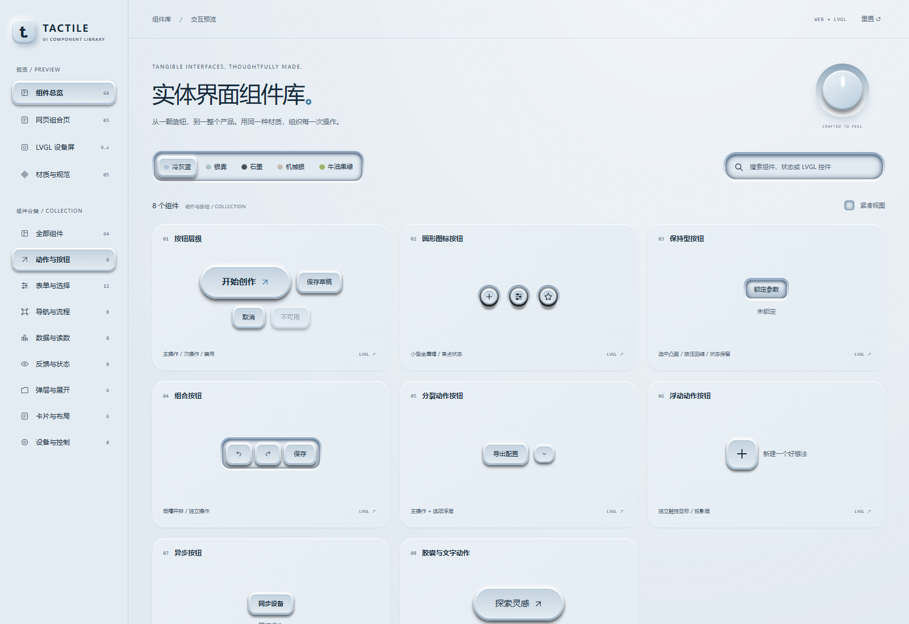

# TACTILE：让网页与设备界面拥有实体触感

一套面向网页和 LVGL 界面的实体触感组件库，同时也是可复用的 Codex 设计技能。

从按钮、输入框到旋钮、仪表和完整页面，TACTILE 用统一的材质、凹凸层次和状态规则组织界面，让每个控件都像属于同一块控制面板。



## 项目亮点

- **64 组常用组件**：覆盖动作按钮、表单选择、导航流程、数据读数、反馈状态、弹层展开、卡片布局和设备控制。
- **5 套主题配色**：冷灰蓝、银雾、石墨、机械银、牛油果绿，组件共享同一套颜色与材质变量。
- **明确的凹凸规律**：按功能决定层次，选中态与未选中态保持可辨认的区别。
- **有结构的实体质感**：独立槽缘、深内腔、双层圆帽、接触影、投影和反光，共同表达控件的厚度。
- **完整交互预览**：主题切换、搜索、下拉选择、开关、滑杆、文件选择、分页、弹层和键盘操作。
- **网页与设备组合页**：3 个网页示例、3 个 800×480 设备页面，用完整布局展示组件之间的关系。
- **Codex 技能资源**：提供 `SKILL.md`、材质配方、组件清单、参考资料和源码，方便在后续设计中复用。

## 凹凸有规律，状态有区别

| 层次 | 适用位置 |
| --- | --- |
| 平面 | 页面底板、正文、辅助文字、浮层菜单内容 |
| 浅凸 | 卡片、模块外壳、设备底座 |
| 凸起 | 主／次动作按钮、移动圆帽、选中的分段／分页／导航项 |
| 凹下 | 输入槽、滑动轨道、进度槽、表格／图表／仪表读数窗 |

选择组的承托槽保持不动，未选中项保留低位凹面或透明样式，选中项升起。按钮按下时缩短投影，保留帽面的层次。

开关、横向滑杆、范围选择和纵向均衡器共用双层圆帽。圆帽位于轨道上方；进度色则嵌在深凹槽内，由槽缘阴影与反光承托。

开关、连接和运行状态使用绿色表示开启或正常、红色表示关闭或断开，并配文字标签。普通选中与进度使用当前主题的强调色。

## 页面示例

**网页**：设备仪表台、创作工作台、产品设置页。

**设备屏幕**：设备控制、系统设置、音频面板；默认设计目标为 LVGL 9.x、800×480。

网页预览采用 HTML、CSS、JavaScript 和 SVG，无需前端构建步骤。LVGL 部分提供 C 样式起点、控件映射与机械材质资源；浏览器设备页用于设计预览，实际工程需接入显示／输入驱动、字体，并按硬件预算实现精细材质。

## 快速预览

解压后进入 `my-product-style` 文件夹，在该目录启动静态 HTTP 服务：

```bash
python -m http.server 8000 --bind 127.0.0.1
```

随后在浏览器访问 `http://127.0.0.1:8000/`。首页包含组件总览、网页组合页、LVGL 设备屏和材质规范，可切换主题并操作组件。

## 在 Codex 中使用

将完整的 `my-product-style` 文件夹复制到以下任一技能目录，并保留 `SKILL.md`、`agents`、`assets` 和 `references`：

- 个人使用：`~/.agents/skills/my-product-style/`。Windows 对应 `%USERPROFILE%\.agents\skills\my-product-style\`。
- 项目内使用：`<项目根目录>/.agents/skills/my-product-style/`。

这些是 Codex 支持的本地技能发现位置，显式调用可在提示中提及技能名称。详见 [OpenAI 官方技能文档](https://learn.chatgpt.com/docs/build-skills)。

网页设计示例：

```text
使用 $my-product-style 设计一个设备管理网页。
采用牛油果绿主题，包含状态卡片、设备表格、搜索、设置和运行控制。
按用途统一凹凸层次，并适配桌面与手机。
```

LVGL 设计示例：

```text
使用 $my-product-style 设计 LVGL 9.x 的 800×480 控制页面。
采用冷灰蓝主题，包含温度读数、亮度滑杆、音量旋钮和底部导航。
提供控件映射与布局，开关和运行状态使用红绿灯及文字标签。
```

## 包内内容

```text
my-product-style/
├── 文案.md                  项目介绍与使用说明
├── SKILL.md                 Codex 技能入口
├── index.html               预览首页入口
├── agents/openai.yaml       技能显示信息与调用设置
├── assets/                  组件源码、页面示例与 LVGL 资源
└── references/              材质规则、组件清单、参考资料与截图
```

当前实现配方见 [最终材质配方](references/final-material-recipes.md)，组件覆盖见 [组件清单](references/web-components.md)，嵌入式适配见 [LVGL 设计说明](references/lvgl-design.md)。

## 设计参考

风格研究参考了 Gemini UI、launch start、声音控制旋钮和真实拟态旋钮，重点吸收其材质分层、深凹槽、机械结构与光影。参考记录和离线资料见 [来源说明](references/source-map.md)。

## 发布简介

TACTILE 是一套面向网页与 LVGL 的实体触感组件库及 Codex 设计技能，包含 64 组组件、5 套主题和完整页面示例。用统一的凹凸层次、双层圆帽、深槽光影与红绿状态反馈，让按钮、旋钮、仪表和页面共享同一种设计语言。
